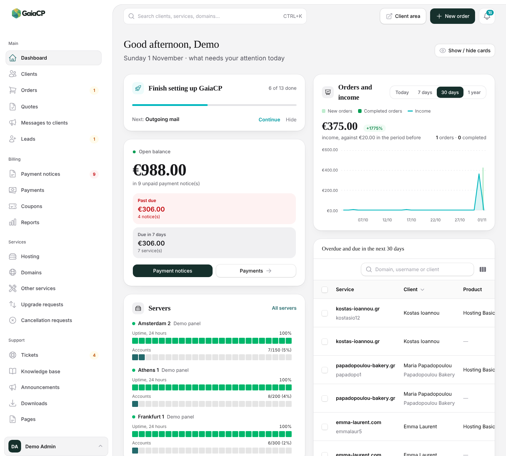
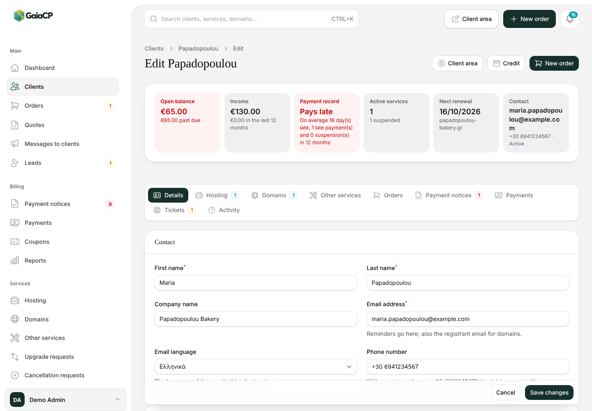
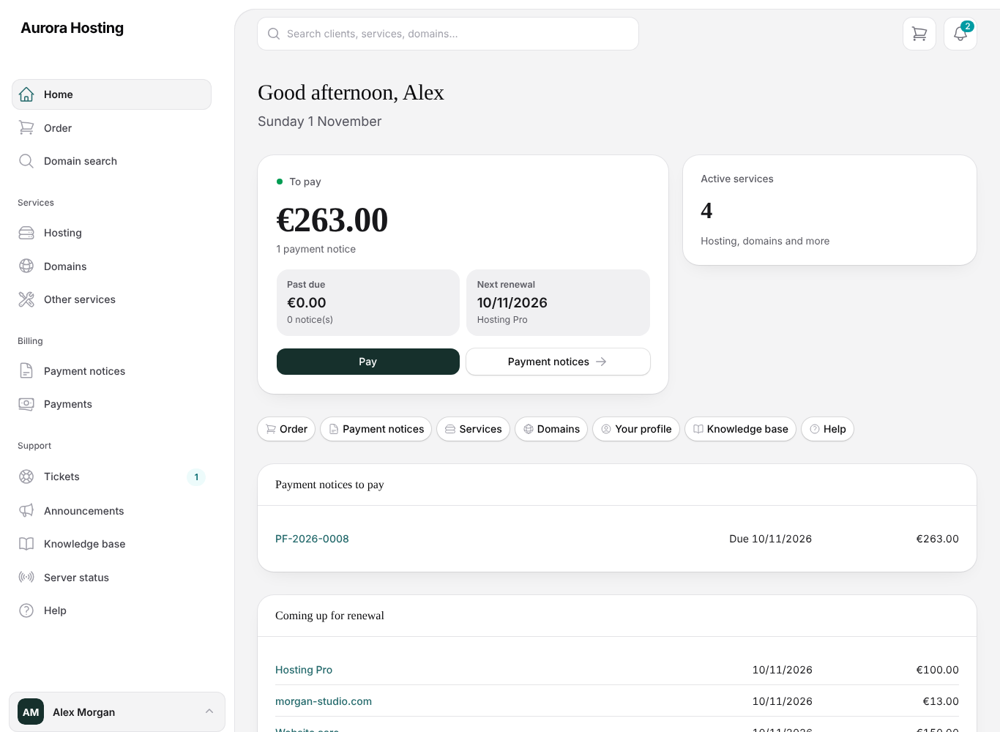
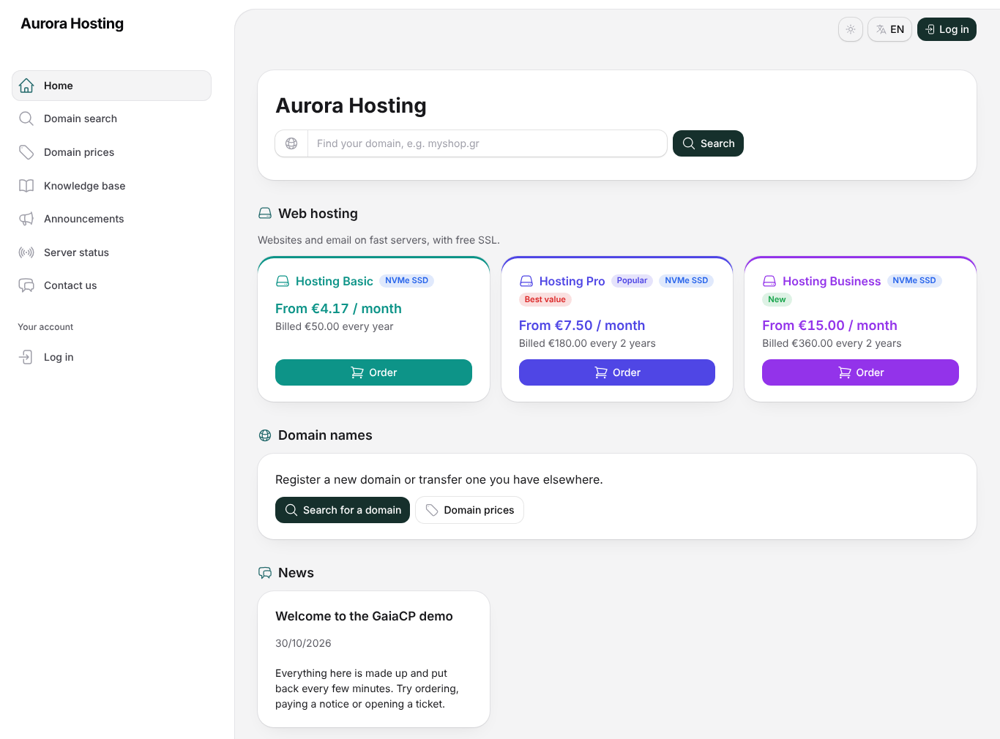
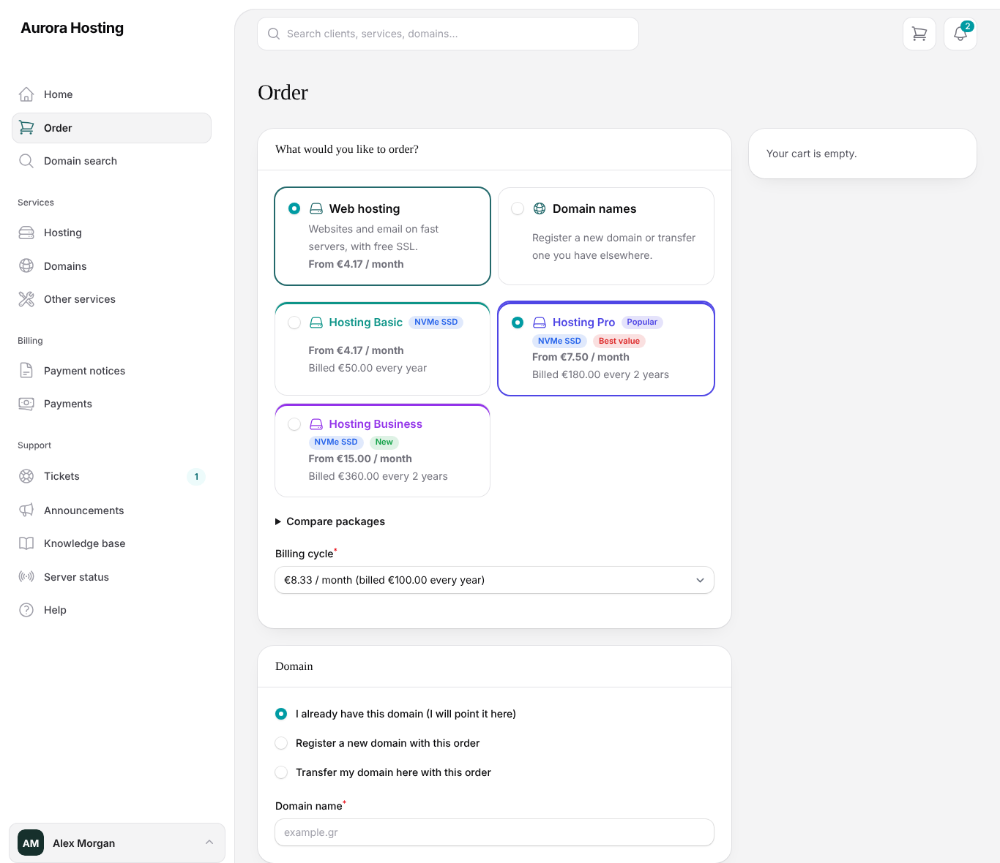
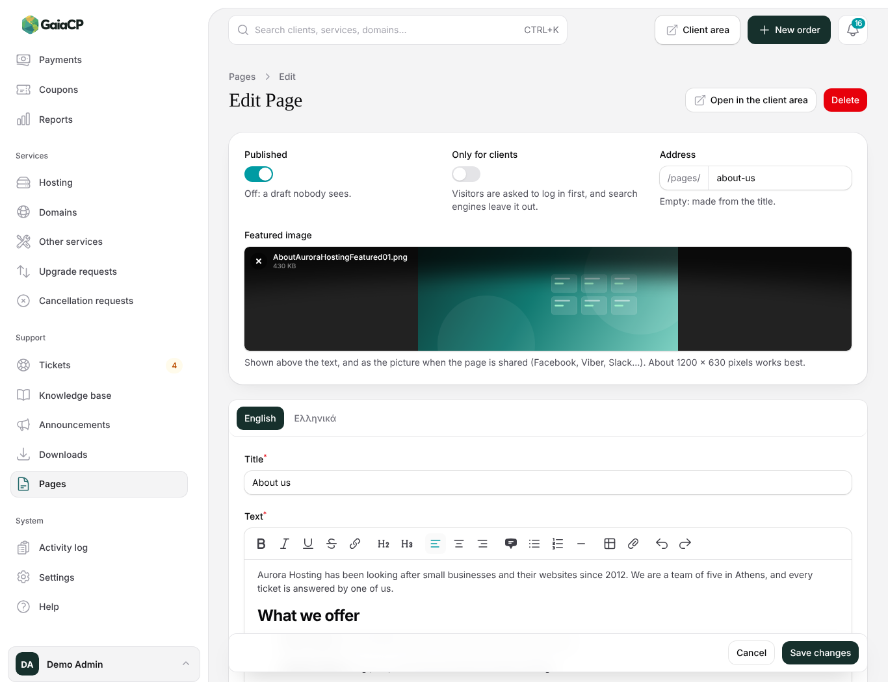
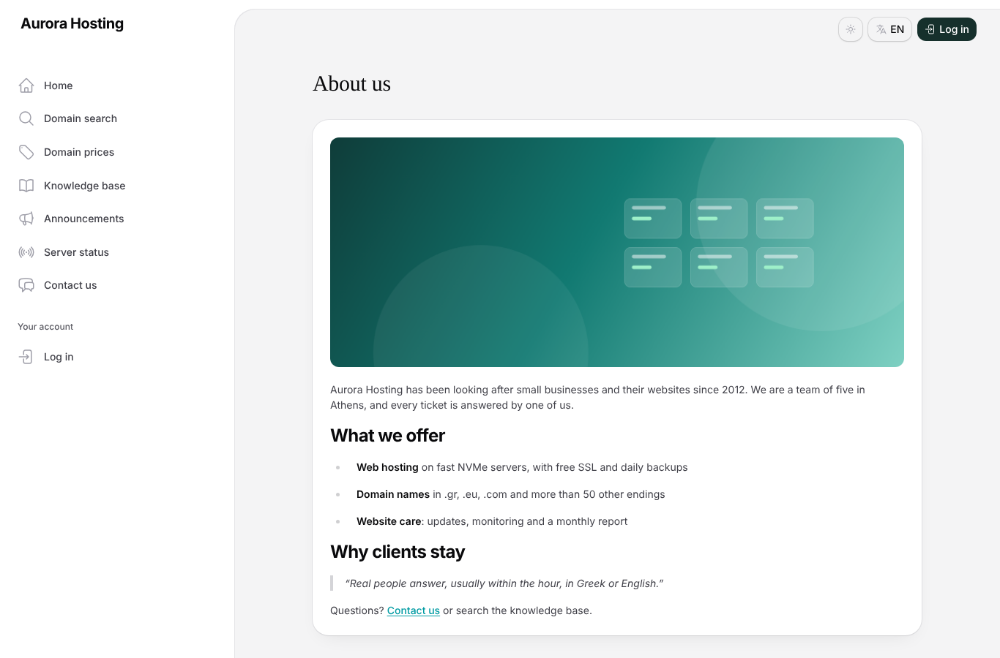

<p align="center">
  <picture>
    <source media="(prefers-color-scheme: dark)" srcset="public/images/gaiacp/logo-dark.svg">
    
  </picture>
</p>

<p align="center">
  <strong>Billing and provisioning for small hosting businesses.</strong><br>
  A simpler, open source take on WHMCS, for one person or a small team selling hosting, domains and SSL.
</p>

<p align="center">
  <a href="https://demo.gaiacp.digital/admin">Try the demo</a> ·
  <a href="docs/installation.md">Install</a> ·
  <a href="docs/admin-guide/README.md">Admin guide</a> ·
  <a href="docs/features.md">All features</a> ·
  <a href="docs/writing-plugins.md">Plugins</a> ·
  <a href="docs/using-the-api.md">API</a>
</p>

> **Alpha.** GaiaCP is still in development: features, settings and the database may change between versions, and
> parts of it haven't been tried against real servers or registrars yet. Keep backups (Settings → System → Backups)
> and read each release's notes before updating.

<p align="center">
  
</p>

## What is GaiaCP?

GaiaCP keeps track of your clients and what they pay you, and does the repetitive work around it: it sends payment
notices and reminders, creates and suspends hosting accounts, registers and renews domains, and gives your clients a
place to order, pay and look after their services. It is built with Laravel and Filament, runs on ordinary shared
hosting with PHP and MySQL, and can be installed at the root of a site or in a subfolder.

It is meant for hosting businesses that find WHMCS too big or too expensive, and for anyone who wants a billing panel
they can read and change.

## Try the demo

The demo at **[demo.gaiacp.digital](https://demo.gaiacp.digital)** has a made-up hosting company in it, put back
every ten minutes, so click anything you like. Nothing leaves the server: no email, no server or registrar calls.

| | Address | Email | Password |
|---|---|---|---|
| Admin panel | [demo.gaiacp.digital/admin](https://demo.gaiacp.digital/admin) | `admin@example.com` | `demo` |
| Client area | [demo.gaiacp.digital](https://demo.gaiacp.digital) | `client@example.com` | `demo` |

## What it does

**Billing**
- Payment notices (proformas) made and emailed before each due date, with reminders and overdue notices
- Automatic suspension of unpaid hosting, and unsuspension once it is paid
- Card payments through Stripe Checkout, PayPal, bank transfer, client credit, tax and EU reverse charge, several currencies
- Optional numbered invoices and credit notes as PDF, issued when a notice is paid, with a CSV export for your accountant
- Coupons, sale prices on products and domain endings, quotes, upgrades and downgrades, price changes with notice,
  add-ons and product options
- Reports: income, forecast, profit per server and per domain ending

**Hosting, domains and SSL**
- Accounts created, suspended and ended on **cPanel / WHM**, **Plesk**, **DirectAdmin**, **HestiaCP**, **CyberPanel** and **Enhance**, and VPS on **Proxmox VE**
- Domains registered, transferred, renewed and synced at **easy.gr** and **Enom**, or by email for any other registrar
- SSL certificates sold and reissued through **GoGetSSL**, validated and installed on your own cPanel / Plesk hosting
- A comparison of each server's accounts with what you bill, and uptime from Uptime Kuma, UptimeRobot, HetrixTools
  or Better Stack

**Your clients**
- A client area where clients order, pay, change nameservers, log in to their hosting panel, open tickets, read the
  knowledge base and download your files, with a short welcome tour on their first visit
- An optional public site: home page, domain search, WHOIS lookup, domain prices, a page for each product group and
  product, package comparison, cart, announcements, server status and a contact form, ready for search engines
  (sitemap, each language at its own address)
- Pages of your own (About us, your terms, a guide) written with an editor, with pictures and a featured image, and
  both side menus arranged as you like: drag pages into order, rename them, add products, links and headings
- Products with their own colour and tags such as New or NVMe SSD, a Popular badge and a sale price
- Support tickets (also from email), leads, messages to clients, editable email templates in each language

**For you**
- A dashboard you arrange yourself, a notifications bell, push notifications on your phone, a setup guide
- Admin users with access levels, two-factor sign-in, passkeys, sign-in links by email, Google sign-in, login
  protection, backups, system health, logs
- An AI assistant (Claude, ChatGPT, DeepSeek or Kimi with your own key, or a local model through Ollama) that
  improves and translates the texts you write, drafts and summarises ticket replies, writes personal payment reminders,
  fills in missing translations and answers questions about your data in plain words
- Webhooks, Slack, Discord and Telegram, a REST API, and an import from WHMCS
- English and Greek built in, plus machine translations into German, Spanish, French, Italian, Dutch, Polish,
  Brazilian Portuguese and Turkish; other languages are uploaded from the panel

Server panels, registrars, payment methods and the rest are **plugins**: turn off what you don't use, install more
from the signed plugin catalogue at [plugins.gaiacp.digital](https://plugins.gaiacp.digital), or write your own.

The full list, and what is planned, is in [docs/features.md](docs/features.md).

## Screenshots

<table>
  <tr>
    <td width="50%"></td>
    <td width="50%"></td>
  </tr>
  <tr>
    <td align="center">A client's page: balance, payment record and every service in tabs</td>
    <td align="center">The client area: what to pay and what renews next</td>
  </tr>
  <tr>
    <td width="50%"></td>
    <td width="50%"></td>
  </tr>
  <tr>
    <td align="center">The public home page, with product colours and tags</td>
    <td align="center">Ordering a package</td>
  </tr>
  <tr>
    <td width="50%"></td>
    <td width="50%"></td>
  </tr>
  <tr>
    <td align="center">Writing a page of your own with the editor</td>
    <td align="center">The same page on your site</td>
  </tr>
</table>

Taken with the [demo](https://demo.gaiacp.digital)'s made-up data, in light mode; dark mode is one click away in the user menu.

## What it doesn't do

- **It never charges cards by itself.** Payments are recorded by you, or by Stripe Checkout or PayPal when the client
  pays there. No saved cards, no automatic charges.
- **Invoices are optional.** Payment notices track what is owed and what was paid; Settings → Invoices can also issue
  a numbered invoice for each paid notice. Sending invoices to a tax authority (myDATA, Peppol…) is not built in.
- No payment gateways other than Stripe and PayPal yet, and no bank statement matching.

## Installation

You need PHP 8.3 or later, a MySQL or MariaDB database and a cron job. No SSH, Composer or Node is needed.

1. Download `gaiacp-<version>.zip` from [Releases](../../releases) and unzip it on your hosting, at the site's root
   or in a subfolder.
2. Create an empty database, then open the site: the installer checks your server, asks for the database and creates
   your admin account.
3. Add the cron line it shows you, log in at `/admin` and follow the setup guide on the dashboard.

Updates are one button under Settings → System → Updates (a backup is made first). Document root, nginx, SSH
installs and the settings: [docs/installation.md](docs/installation.md).

## Documentation

| For | Read |
|---|---|
| Running your business with GaiaCP | [Admin guide](docs/admin-guide/README.md) (English and [Ελληνικά](docs/admin-guide/el/01-getting-started.md); also in the panel under System → Help) |
| Installing, updating, cron and settings | [docs/installation.md](docs/installation.md) |
| How billing, panels, registrars and the WHMCS import work | [docs/reference.md](docs/reference.md) |
| Writing a plugin | [Tutorial](docs/plugin-tutorial.md), [reference](docs/writing-plugins.md), [plugin catalogue](docs/plugin-catalogue.md) |
| Scripts and other sites | [REST API](docs/using-the-api.md) |
| Your own demo | [docs/demo-site.md](docs/demo-site.md) |
| Releases | [docs/releases.md](docs/releases.md), [CHANGELOG.md](CHANGELOG.md) |

## Development

```bash
composer install
cp .env.example .env
php artisan key:generate
php artisan migrate --seed   # demo data; log in as admin@example.com / password
php artisan serve            # then open http://localhost:8000/admin
```

Run the tests with `php artisan test` and the code style check with `./vendor/bin/pint`. SQLite is enough; there is
no front-end build step.

## Contributing

Bug reports, translations, plugins and pull requests are welcome: see [CONTRIBUTING.md](CONTRIBUTING.md). Everyone
taking part follows the [code of conduct](CODE_OF_CONDUCT.md). Please report security issues privately, as
[SECURITY.md](SECURITY.md) explains, not in a public issue.

## Licence

GaiaCP is free software: you can redistribute it and/or modify it under the terms of the GNU General Public License
as published by the Free Software Foundation, either version 3 of the License, or (at your option) any later version.
It is distributed in the hope that it will be useful, but WITHOUT ANY WARRANTY; without even the implied warranty of
MERCHANTABILITY or FITNESS FOR A PARTICULAR PURPOSE. See [LICENSE](LICENSE) for the full text.

### Disclaimer

GaiaCP is provided "as is", without warranty of any kind, as sections 15 and 16 of the licence say. You use it at
your own risk: its authors and contributors are not liable for any loss or damage it causes, such as wrong amounts,
missed or duplicate emails, suspended or deleted accounts on your servers, or lost data. Check what it does before you
rely on it, test it with your own servers and registrars, and keep backups.

Plugins in `plugins/` are part of GaiaCP and under the same licence. Third-party libraries in `vendor/` keep their own
licences.
